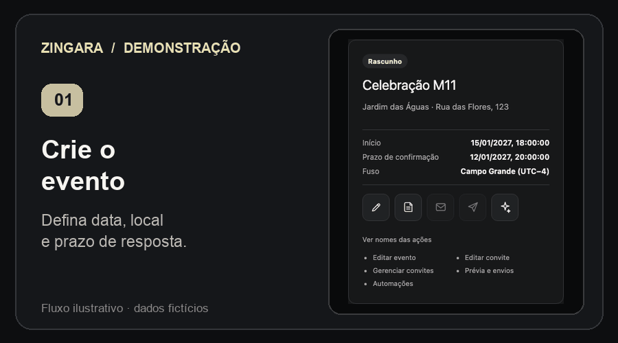
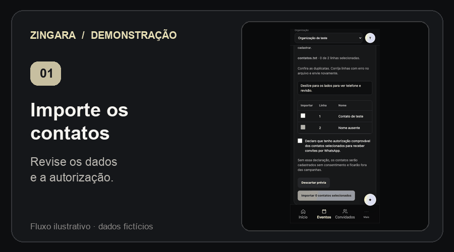

# Zingara Convites

**Convites digitais, confirmações e comunicação por WhatsApp em um só fluxo.** Projeto de portfólio e estudo de uma aplicação para organizar eventos sem depender de planilhas, links genéricos e conferência manual de respostas.

> As demonstrações abaixo usam dados fictícios de testes automatizados. Nenhuma mensagem real é enviada nelas.

**Convite e confirmação**



**Campanha de WhatsApp**



Gravações da interface em testes automatizados: [revisão de campanha](docs/media/campanha-gravacao.gif) · [relatório do evento](docs/media/relatorio-gravacao.gif).
Capturas estáticas: [convite no celular](docs/media/convite-mobile.png) · [revisão da campanha](docs/media/campanha-revisao.png).

## O que a aplicação faz

1. **Cria o evento e o convite:** define local, data, prazo de resposta, arte e mensagem; publica uma versão do convite.
2. **Organiza os convidados:** importa contatos, registra a origem da autorização para WhatsApp e emite links individuais.
3. **Envia com revisão humana:** prepara uma campanha com prévia por destinatário, intervalo entre mensagens e aprovação explícita. A integração usa a **Evolution API** (Baileys ou WhatsApp Cloud API).
4. **Acompanha as respostas:** o convidado confirma ou recusa pelo próprio link. O painel reúne RSVP, estados de entrega e lista de confirmados.

As automações podem programar lembretes e avisos. Antes de cada tentativa, o worker confere prazo, resposta, autorização, opt-out e estado da conexão. O assistente do painel ajuda a navegar e preparar etapas, mas não aprova envios.

## Por dentro

Monorepo em **TypeScript**, **Nuxt/Vue**, **Node/Nitro**, **MongoDB**, **Redis/BullMQ** e **Playwright**. O painel administrativo, o convite público, a API e o worker rodam como aplicações separadas. Veja a [visão técnica](docs/overview.md).

## Rodar localmente

Requer **Node 24**, **pnpm 11.17.0** e **Docker**. No primeiro uso deste checkout, escolha o e-mail e informe uma senha forte no terminal:

```bash
pnpm worktree:setup --id zingara-local
docker compose --env-file .env -f infra/compose.dev.yml up -d --wait
export ADMIN_BOOTSTRAP_EMAIL=admin@example.com
read -r -s ADMIN_BOOTSTRAP_PASSWORD
export ADMIN_BOOTSTRAP_PASSWORD
pnpm admin:bootstrap
unset ADMIN_BOOTSTRAP_PASSWORD
pnpm dev
```

`pnpm worktree:setup` cria o `.env` local ignorado pelo Git; consulte nele `ADMIN_ORIGIN` e `INVITE_ORIGIN` para abrir as interfaces. Para verificar o projeto, execute `pnpm check` com MongoDB e Redis ativos.

## Documentação

[Contribuição](CONTRIBUTING.md) · [Visão técnica](docs/overview.md)

**Uso acadêmico e de portfólio.** As imagens e os GIFs são de testes com dados fictícios. Configure credenciais próprias antes de integrar o WhatsApp; campanhas reais exigem autorização dos destinatários e aprovação no painel.
