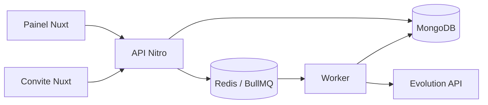

# Visão técnica

O Zingara separa o painel privado do convite público. Cada interface acessa a API por um proxy próprio; o navegador não recebe credenciais do provedor de WhatsApp.

O MongoDB guarda eventos, convidados, convites, respostas, campanhas e histórico. O Redis agenda tarefas; o worker revalida elegibilidade antes do envio. A Evolution API integra WhatsApp por Baileys ou Cloud API. Links individuais são protegidos por token, e ações administrativas exigem sessão e autorização por organização.

No ambiente local, o provedor usa modo **fake**. As demonstrações do README usam contatos fictícios e não disparam mensagens. Para validar o código com MongoDB e Redis ativos, execute `pnpm check`; o workflow de CI executa a mesma verificação em pull requests.
